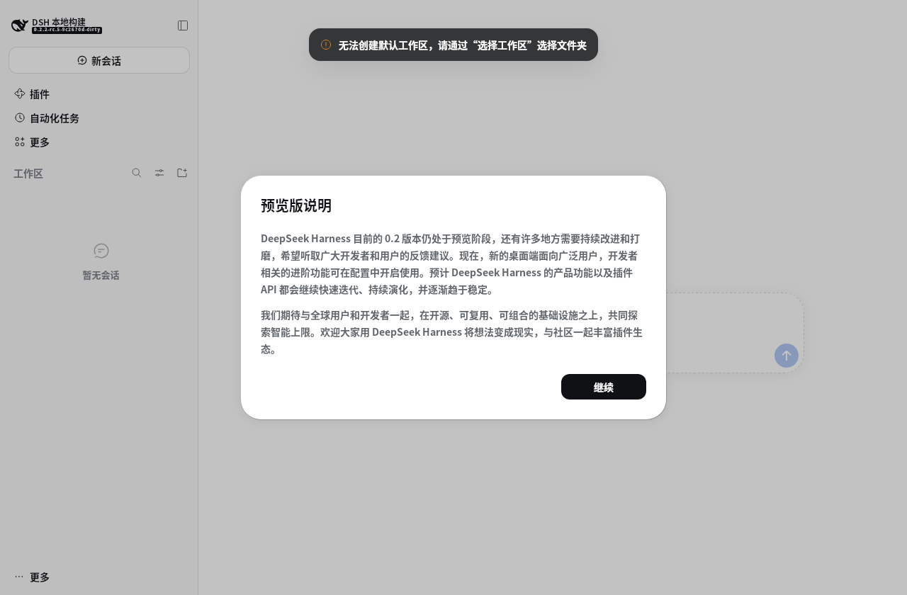

# dsh on FreeBSD — standalone overlay

English | [中文](README.zh.md) | [中文完整手册](docs/zh/README.md)

This tree carries the FreeBSD layer for **DeepSeek Harness (`dsh`)**, decoupled
from the upstream monorepo. It is applied to an untouched upstream checkout and
built on FreeBSD 15+.

Pinned upstream: `dsh-v0.2.2-rc.5` (`9c2670d3bce5275e0d1610272958121af87787bb`),
see [VERSION](VERSION).

## Why an overlay instead of a fork

The previous FreeBSD distribution was a full fork of `deepseek-harness`. Every
upstream release meant merging thousands of commits, re-porting code that had
moved, and re-auditing a dozen scattered FreeBSD edits. The fork history made the
FreeBSD delta invisible.

This overlay keeps only that delta:

- **6 patches** against the pinned upstream commit (build config, native addon,
  jail sandbox, platform runtime, headless fixes, docs index).
- **39 overlay files** the upstream tree does not have (the `freebsd/` operations
  scripts, the setuid jail helper source, the FreeBSD runbooks, the port).

Everything else — the agent, plugins, web UI, tests — comes from upstream
unchanged. `scripts/apply.sh` fails loudly instead of silently dropping a FreeBSD
fix when upstream moves a file.

## Requirements (FreeBSD 15.x, amd64)

```sh
pkg install -y git node24 npm-node24 gmake python3 pkgconf bash ripgrep
npm install -g pnpm@11.28.5
```

- **Node 24** is what upstream declares (`engines: >=24.9`). Node 22.19+ also
  builds and runs; it prints an `Unsupported engine` warning during install and
  must rebuild the native addons.
- **pnpm must come from npm**, not corepack. corepack installs the native
  `@pnpm/exe` launcher, which fails identity verification on FreeBSD
  (`Cannot verify the identity of the @pnpm/exe.freebsd-x64 native binary`).
- **GNU make**: node-gyp compiles `node-pty` on FreeBSD. `scripts/build.sh`
  prepends a `make -> gmake` shim automatically, so the system BSD make does not
  matter.
- **bash** is a runtime dependency of the `terminal-bash` backend; FreeBSD's
  `/bin/sh` cannot substitute.
- **ripgrep** provides the system `rg` the grep/glob tools fall back to, because
  `@vscode/ripgrep` has no FreeBSD binary.

`sh scripts/check-prereqs.sh` verifies all of this and prints the missing package.

## Build

```sh
git clone <this-overlay> ~/dsh-freebsd
cd ~/dsh-freebsd
sh scripts/build.sh
```

`build.sh` clones upstream at `UPSTREAM_TAG`, applies the overlay, runs
`pnpm install --frozen-lockfile`, then `pnpm run build`, then verifies the
result. Work happens in `.work/tree`; logs land in `.work/logs/`.

When GitHub is unreachable (mainland China), use the checkout you already have or
a mirror:

```sh
# extract the pinned commit from an existing clone (no network)
sh scripts/build.sh --from-local /path/to/deepseek-harness

# mainland China mirrors
DSH_NPM_REGISTRY=https://registry.npmmirror.com \
DSH_NODE_DISTURL=https://registry.npmmirror.com/-/binary/node \
sh scripts/build.sh --from-local /path/to/deepseek-harness
```

Useful flags: `--tree DIR`, `--skip-install`, `--skip-build`, `--no-verify`,
`--registry URL`, `--node-disturl URL`. If the lockfile disagrees with the patched
manifests, `DSH_ALLOW_LOCK_UPDATE=1` drops `--frozen-lockfile`.

## Run

Built tree:

```sh
cd .work/tree
node --expose-internals apps/cli/lib/bin.js web --host 127.0.0.1 --port 3080 --no-open
node --expose-internals apps/cli/lib/bin.js --help
```

Source tree (what the service scripts use):

```sh
pnpm dsh:freebsd web
```

`--expose-internals` is mandatory on FreeBSD: `node-addon-require-builtin` ships
no FreeBSD prebuild and no source fallback, so the internal ESM loader is the only
route the HMR service has.

## Desktop app (one-click)

The overlay installs a real desktop app: a native **WebKitGTK** window that
starts the harness on loopback, opens the UI, and stops the server when you close
the window. Electron is not involved (it has no FreeBSD target); if WebKitGTK is
unavailable the launcher falls back to a Chromium `--app` window.



```sh
# runtime bundle (once per build)
sh scripts/bundle.sh .work/tree-final 0.2.2-rc.5

# install for the current user (~/.local); --prefix /usr/local as root
sh desktop/install-desktop.sh

# start it
~/.local/bin/dsh-desktop        # or "DeepSeek Harness" in the application menu
```

Package it for another FreeBSD 15 machine:

```sh
sh scripts/package-desktop.sh
# .work/desktop/dsh-desktop-0.2.2-rc.5-freebsd-amd64.tar.gz
#   unpack, then: sh install-desktop.sh
```

Behavior:

- One server per harness home. A second launch opens another window against the
  running server instead of starting a second one.
- Closing the last window stops the server, but only the launcher that started it
  stops it.
- State and logs: `${XDG_STATE_HOME:-~/.local/state}/dsh-desktop/`.
- `DSH_DESKTOP_HOME` selects the harness home (default `~/.dsh`),
  `DSH_DESKTOP_PORT` the preferred port (3080, or the first free one).
- `~/.config/dsh-desktop/env` is sourced (and exported) before launch, so
  deployment settings such as `DSH_PERMISSION_MODE` or `DSH_JAIL_RUN_BIN`
  survive a menu launch. Without the setuid jail helper the confined modes fail
  closed; `DSH_PERMISSION_MODE=danger-full-access` there is the documented
  escape hatch, not the default.
- Uninstall: `sh desktop/install-desktop.sh --uninstall`.

Requirements: Node.js (node24) for the runtime, and either `webkit2gtk-4.1`
(native window, compiled at install time) or Chromium. The window is built from
the small C program in `desktop/dsh-desktop.c`; the installer also validates the
`.desktop` entry and refreshes the menu and icon caches.

## What the patches carry

| Patch | Contents |
| --- | --- |
| `0001-build-config` | pnpm `supportedArchitectures` for `freebsd` + `wasm32`, sharp WASM `packageExtensions`, 8 GiB V8 heap on the host/client builds, the `node-pty` spawn-helper patch, `dsh:freebsd` script, regenerated lockfile. |
| `0002-native-system` | `@deepseek-ai/node-addon-system-freebsd-x64`: a Node-API `flock(2)` binding, plus the build/test matrix that produces and validates `native/system/packages/freebsd-x64/bin/system.node`. Without it the JSONL session store cannot take its cross-process write lease. |
| `0003-sandbox-jail` | Wires `freebsd-jail` into the local sandbox provider (platform chain, static enforcement, denial signatures, runner argv/probe) and replaces the fail-closed `SANDBOX_UNAVAILABLE` behavior with the setuid `dsh-jail-run` backend. |
| `0004-platform-runtime` | FreeBSD `ps` syntax in the process inspector, the bash hard requirement in `terminal-bash`, the `DSH_RIPGREP_PATH` / system-`rg` fallback in `util/ripgrep`, the desktop-opener probe, the loader's FreeBSD `requireInternal` guard, and the Web Crypto polyfill for the web UI. |
| `0005-headless-fixes` | Sharp's WASM backend on FreeBSD needs descriptors 0/1/2 to be statable before load; the repair lives here. The settings controller returns the document path instead of failing when the serving host has no desktop opener. |
| `0006-postmortem-index` | Indexes the bad-stdio-descriptor postmortem that documents the fixed crash. |

The overlay files under [overlay/](overlay) are:

- `freebsd/` — jail helper source, web launcher/restart scripts, the rc.d service,
  the one-shot service installer, sandbox and service verifiers.
- `FREEBSD.md`, `freebsd-sandbox.md`, `freebsd-startup-troubleshooting.md` (+ `.zh`)
  — the FreeBSD runbooks.
- `dsh-freebsd-port/` — the FreeBSD port tree, kept for packaging; it currently
  pins the older `0.2.1a4` distfile and needs a new hosted bundle before
  `make install` from the port matches this overlay's build.
- Agent notes and the postmortem that explain the FreeBSD decisions.

CI workflows, README branding, and the fork-only push/sync/audit scripts are
intentionally not carried.

## Jail sandbox (optional, root)

The overlay builds a real `jail(2)` confinement backend instead of forcing
`danger-full-access`:

```sh
# compile and install the setuid helper (root)
cc -O2 -Wall -ljail -o /usr/local/sbin/dsh-jail-run freebsd/dsh-jail-run.c
chmod 4755 /usr/local/sbin/dsh-jail-run

# the helper must live on a non-nosuid filesystem; /var is the usual fallback
cc -O2 -Wall -ljail -o /var/dsh-jail-run freebsd/dsh-jail-run.c
chmod 4755 /var/dsh-jail-run
export DSH_JAIL_RUN_BIN=/var/dsh-jail-run
```

The local sandbox provider selects `freebsd-jail` automatically once the helper
answers its probe. `freebsd/run-verify.sh` runs the standalone 10-check
confinement suite; `freebsd/run-e2e.sh` runs the e2e case. Both need the helper
installed. See [freebsd-sandbox.md](freebsd-sandbox.md) for the threat model.

## Service

```sh
sh freebsd/install-service.sh --with-jail-helper   # install + start + verify
sh freebsd/dsh-web-restart.sh status|restart|stop
```

The service runs the source tree through `pnpm dsh:freebsd web`. It binds to
`127.0.0.1`; the harness rejects non-loopback access with HTTP 403, so use an SSH
tunnel for remote access.

## Updating to a new upstream release

1. Edit [VERSION](VERSION): `UPSTREAM_TAG`, `UPSTREAM_COMMIT`, and bump
   `OVERLAY_VERSION`.
2. Run `sh scripts/build.sh` against a fresh tree. If upstream moved a patched
   file, `apply.sh` names the patch that no longer applies.
3. Resolve the conflict in a git work tree (clone upstream, apply, fix, commit).
4. Run `sh scripts/regen.sh <tree>` to regenerate the patch series and overlay
   files from that tree. `--check` reports drift without writing.
5. Rebuild and run `sh scripts/verify.sh .work/tree`.

## Verification

`sh scripts/verify.sh .work/tree` checks the CLI artifact, the web UI bundle,
the FreeBSD flock addon, the jail helper compile, `--version`, and a loopback web
boot against a scratch `DSH_HOME` (token + HTTP 200). `--tests` adds the focused
unit tests (`util/ripgrep`, `util/native-command`, sandbox local).

`sh scripts/bundle.sh .work/tree-final` then packages that tree as a
self-contained runtime tarball (the `pnpm deploy` closure, web UI, flock addon,
jail helper source) and boots it on a scratch port. The 0.2.2-rc.5 run produced
155,642,193 bytes with a passing smoke (HTTP 200 with the token, 401 without)
and no absolute build-host symlinks; `lib/bin.js --version` works after
extraction anywhere. `distinfo.fragment` and `pkg-plist.fragment` next to the
tarball feed the FreeBSD port.

The build recorded in this revision was run on **FreeBSD 15.1-RELEASE-p7 amd64**
(16 cores / 16 GB, Node 22.23.5, pnpm 11.28.5): six patches applied to a pristine
`dsh-v0.2.2-rc.5` tree, `pnpm install` reused 1428 store packages and compiled
`node-pty` against the FreeBSD headers, `pnpm run build` finished in **213 s**
with **10/10 gates** and **371 client artifacts**, and every verification check
above passed.

## Troubleshooting

| Symptom | Cause / fix |
| --- | --- |
| `Cannot verify the identity of the @pnpm/exe.freebsd-x64 native binary` | pnpm came from corepack. Remove it and `npm install -g pnpm@11.28.5`. |
| `Unsupported engine` warning | Node is below 24.9. Builds still work; install `node24` for the supported line. |
| `FATAL ERROR: Ineffective mark-compacts near heap limit` (exit 134) | V8 heap cap, not the kernel OOM killer. The build pins 8 GiB; close other memory-heavy processes. |
| `tsc -b` fails on a package that no longer exists | A reused tree has stale `node_modules`/`lib` shells. Use a fresh `.work/tree` or `pnpm run clean`. |
| grep/glob fails with a missing rg binary | `pkg install ripgrep`; the overlay falls back to system `rg`. |
| `SANDBOX_UNAVAILABLE` | The setuid `dsh-jail-run` helper is not installed or not executable; see the jail section. |
